<p align="center"><a href="./README.md">العربية</a> · <strong>English</strong></p>

<h1 align="center">AI Gateway Chat</h1>

<p align="center">
An educational project for building an AI chat experience on the web and through a REST API, with persistent conversations and support for multiple AI providers.
</p>

## Screenshots

<p align="center">
  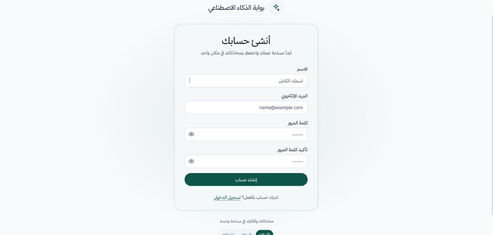
  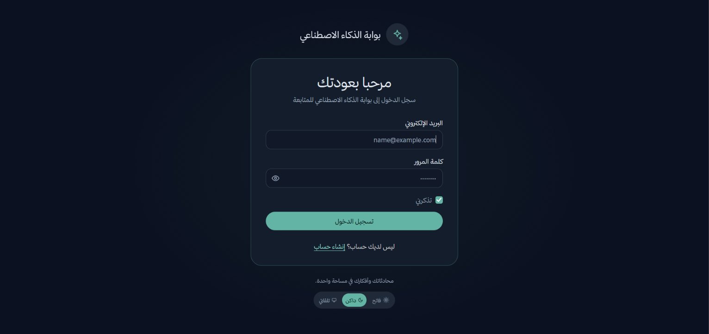
</p>

<p align="center">
  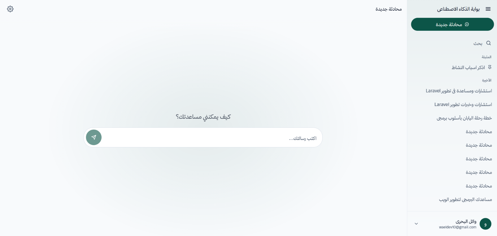
  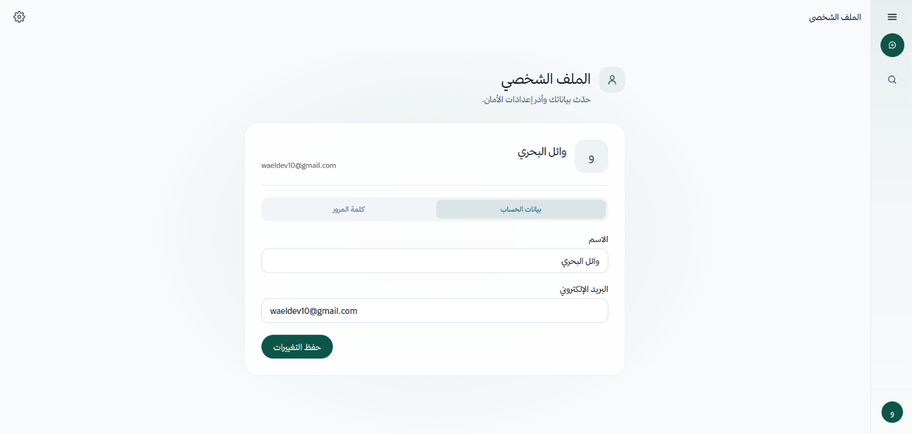
</p>

<p align="center">
  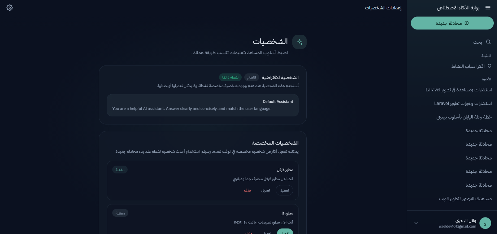
  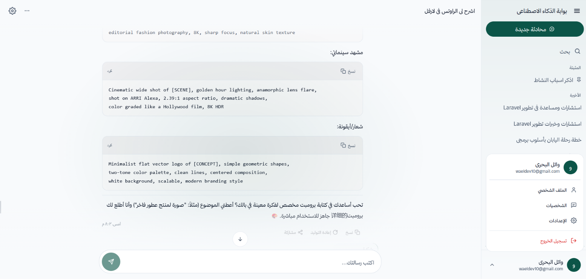
</p>

<p align="center">
  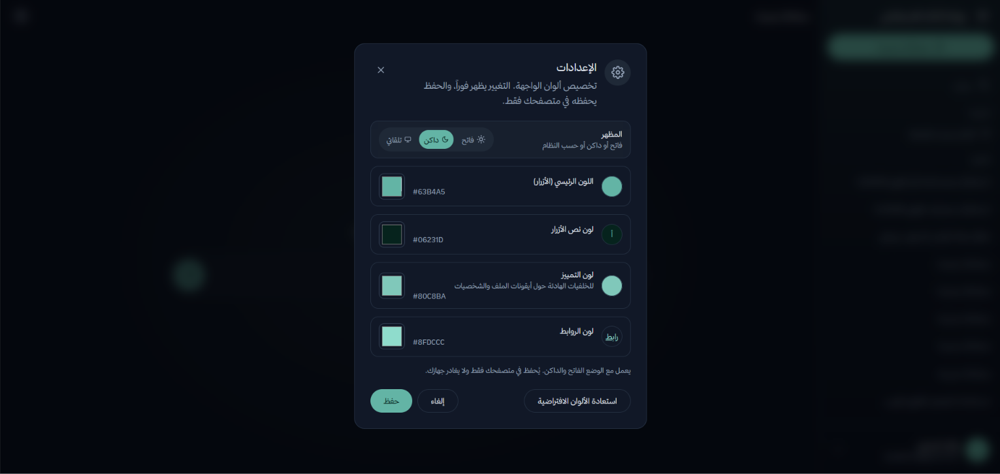
  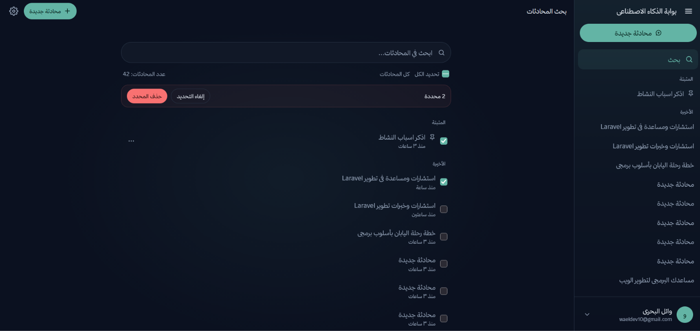
</p>

<p align="center">
  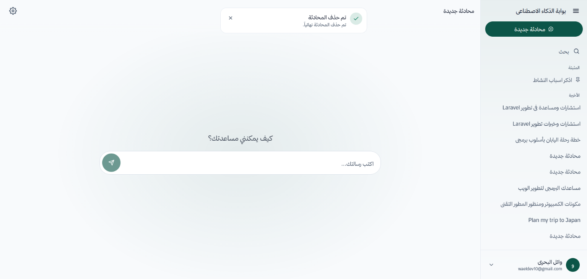
  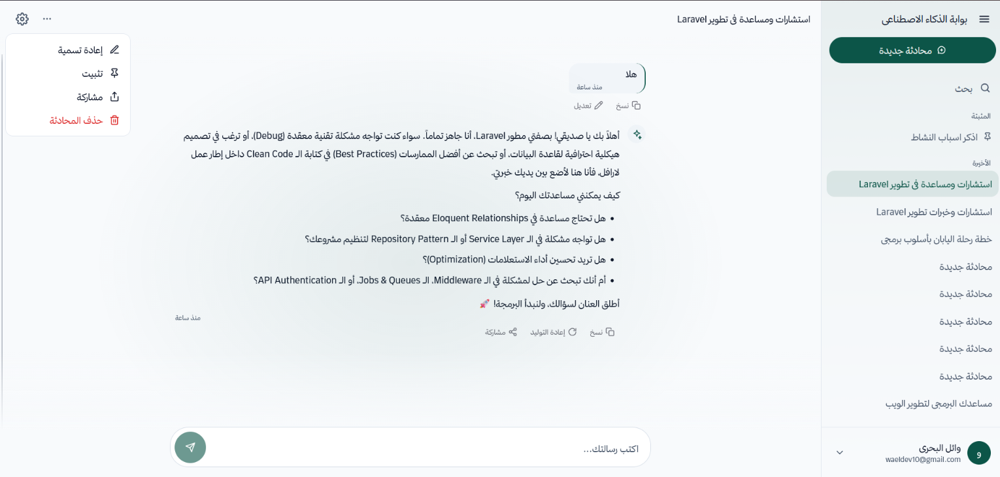
</p>

<p align="center">
  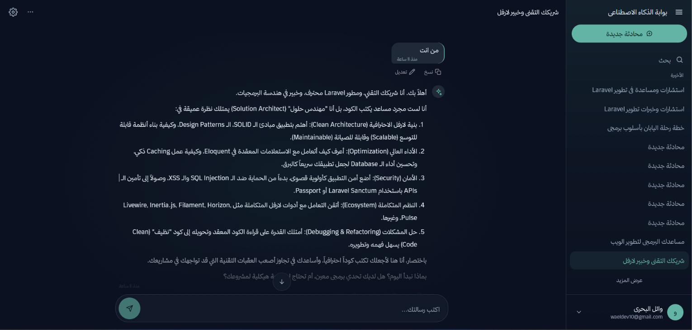
  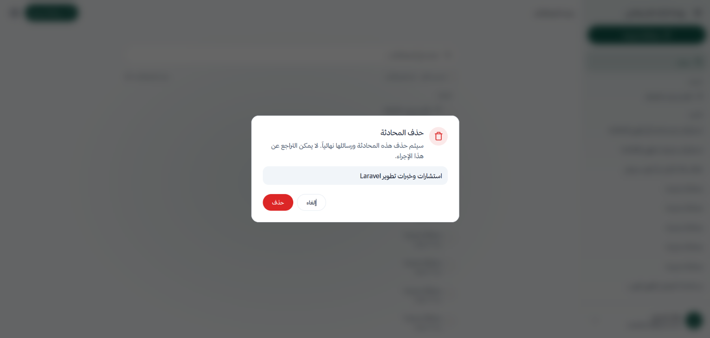
</p>

<p align="center">
  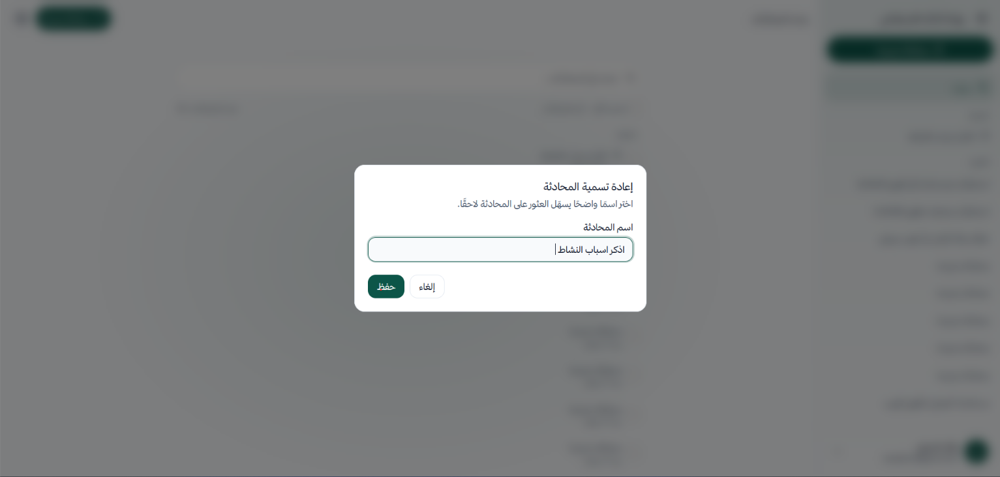
  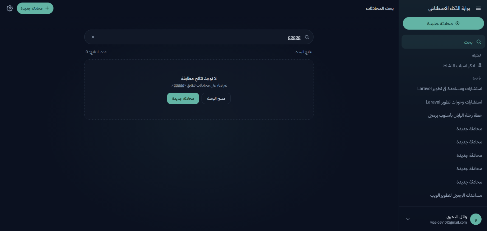
</p>

## Features

### Web application

- Account registration, sign-in, and profile management.
- Create, search, pin, rename, and delete conversations.
- Stream assistant responses and load older messages while scrolling through long conversations.
- Edit user messages and regenerate assistant replies.
- Create and manage assistant personas, including the active persona.
- Light and dark themes, customizable interface colors, Arabic, and RTL support.
- Render code blocks with a copy button.

### REST API

- Versioned API under `/api/v1`, authenticated with Sanctum bearer tokens.
- Registration, sign-in, token revocation, profile updates, and password changes.
- Conversation creation and management, title search, and page-based pagination.
- Start a conversation with its first message and reply; send, edit, and regenerate messages.
- Cursor-based message pagination and persona management.
- Consistent validation and error response formats.

The web interface streams AI responses. API generation requests are synchronous. See the [API guide](docs/api/api.md) and [OpenAPI specification](docs/api/openapi.yaml) for endpoint details and examples.

## Technology stack

| Area | Technologies |
| --- | --- |
| Backend | PHP 8.3+, Laravel 13 |
| Interactive UI | Livewire 4, Alpine.js |
| Styling and assets | Tailwind CSS 4, Vite 8 |
| Database | MySQL by default in `.env.example`, with Eloquent and migrations |
| API authentication | Laravel Sanctum |
| Tests | Pest |

The web interface uses Livewire and shared application services, which call the provider selected in the AI layer. The API receives requests through Form Requests, Controllers, and Resources, then uses the same conversation services.

## AI providers

The AI layer supports the Chat Completions, OpenAI Responses, Anthropic Messages, and Gemini Interactions protocols. `config/ai.php` includes connection profiles for providers such as OpenAI, OpenRouter, Anthropic, Gemini, DeepSeek, Ollama, Qwen, Kimi, and Grok.

To add a provider, list its environment variable names in `.env.example` as `KEY=value` placeholders, without real credentials. Then add a connection in `config/ai.php` that reads those values with `env(...)` and defines its `driver`, `api_key`, `base_url`, `model`, and `timeout`, plus any protocol-specific settings. Follow the existing connection structure. Reuse an existing driver when the provider supports one of the implemented protocols; a new protocol also requires a driver class and a mapping in `AiDriverFactory`. Put real values in your local `.env` only, and never commit API keys.

## Local setup

### Requirements

- PHP 8.3 or later with the extensions required by Composer.
- Composer.
- MySQL and a database the application can access.
- Node.js and npm.

### Installation

From the project directory, install the PHP dependencies:

```bash
composer install
```

If `.env` does not exist, copy `.env.example` to `.env`. In PowerShell:

```powershell
Copy-Item .env.example .env
```

Configure the database connection in `.env` and create the database. The example uses `ai_gateway_chat`:

```dotenv
DB_CONNECTION=mysql
DB_HOST=127.0.0.1
DB_PORT=3306
DB_DATABASE=ai_gateway_chat
DB_USERNAME=your_username
DB_PASSWORD=your_password
```

Generate the application key:

```bash
php artisan key:generate
```

Select an AI provider and configure its environment variables. For example, an OpenAI connection uses:

```dotenv
AI_CONNECTION=openai
OPENAI_API_KEY=your_api_key
OPENAI_MODEL=your_model
```

Run the migrations and seed the default persona, then install and build the frontend assets:

```bash
php artisan migrate --seed
npm install
npm run build
```

### Run in development

Start Laravel in one terminal:

```bash
php artisan serve
```

Start Vite in a second terminal:

```bash
npm run dev
```

Open `http://localhost:8000` and create an account to get started.

## Tests and formatting

```bash
php artisan test --compact
vendor/bin/pint --test
```

## License

This project is licensed under the [MIT License](https://opensource.org/licenses/MIT).
