<p align="center"><strong>العربية</strong> · <a href="./README.en.md">English</a></p>

<h1 align="center">بوابة المحادثة الذكية</h1>

<p align="center">
تطبيق تعليمي لبناء تجربة محادثة بالذكاء الاصطناعي عبر الويب وواجهة REST API، مع حفظ المحادثات ودعم عدة مزودي AI.
</p>

## لقطات من التطبيق

<p align="center">
  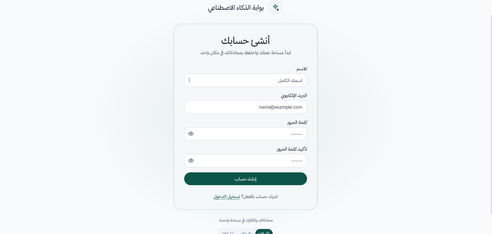
  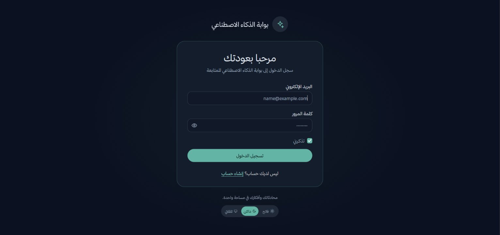
</p>

<p align="center">
  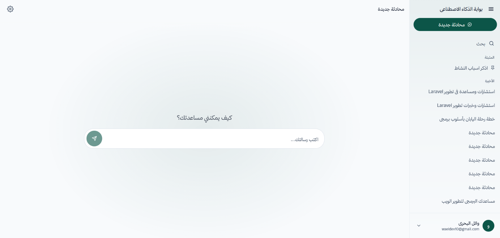
  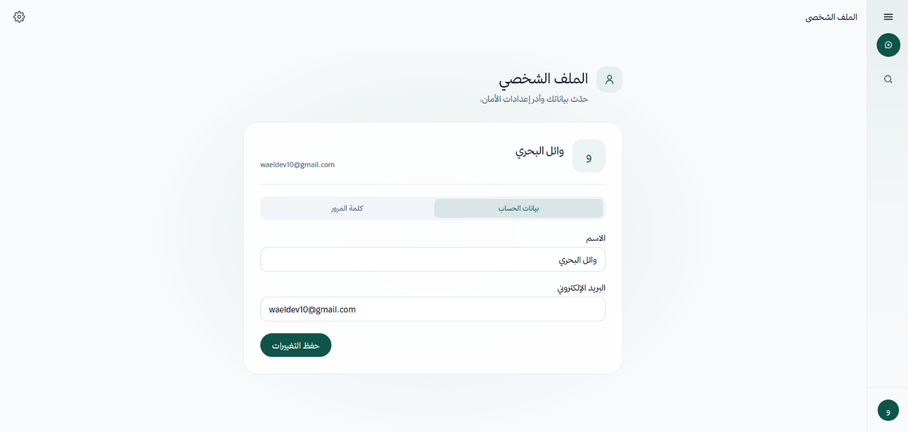
</p>

<p align="center">
  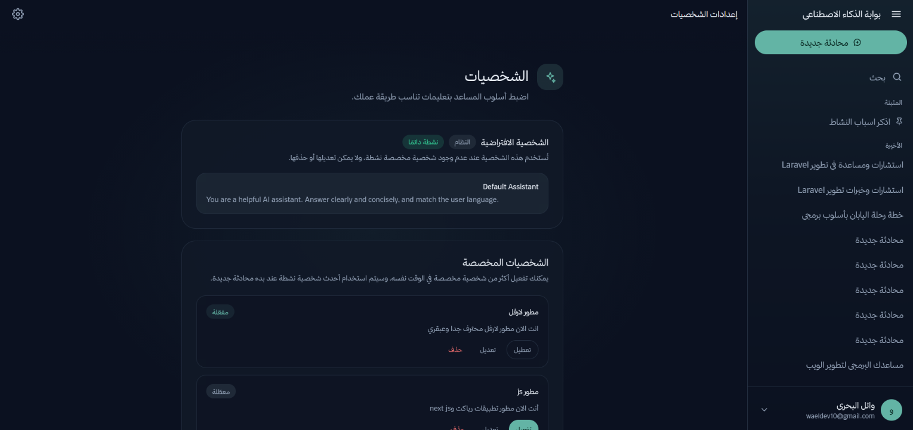
  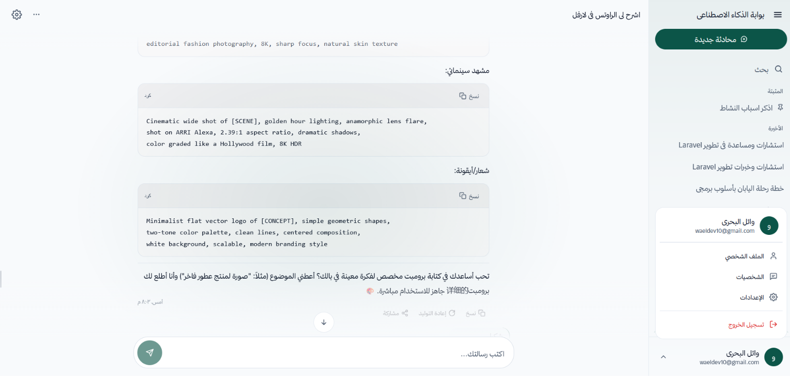
</p>

<p align="center">
  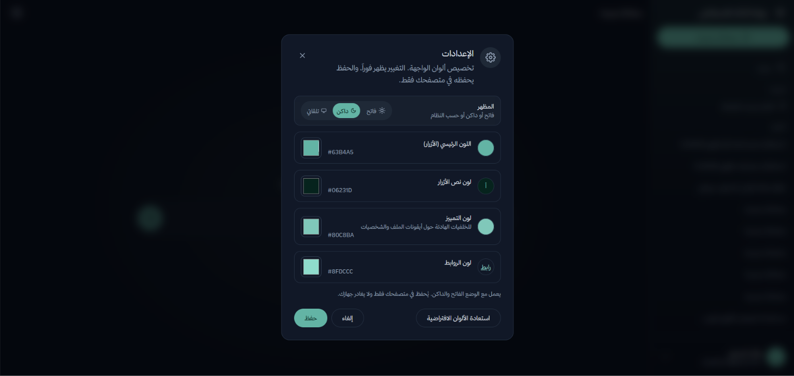
  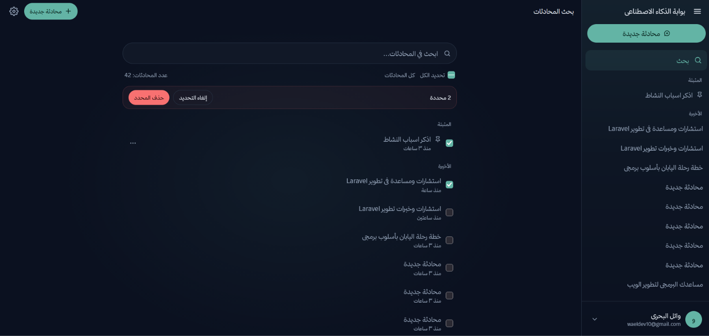
</p>

<p align="center">
  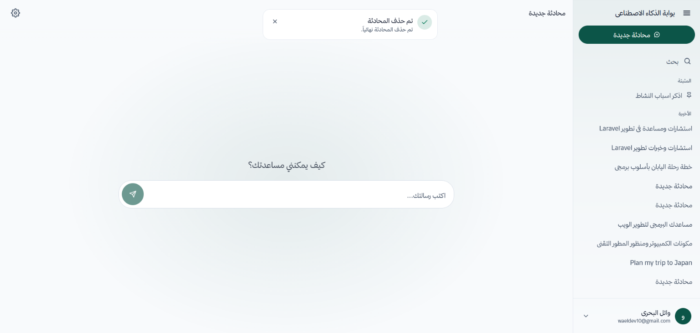
  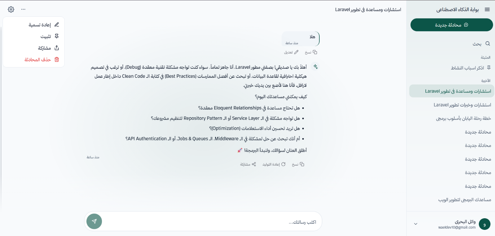
</p>

<p align="center">
  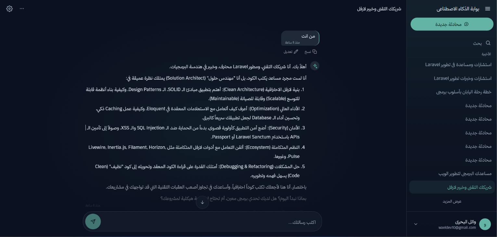
  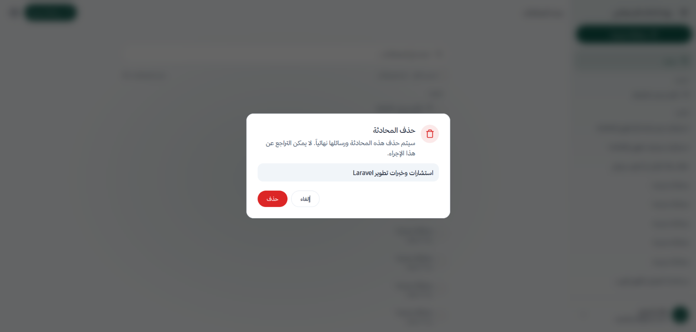
</p>

<p align="center">
  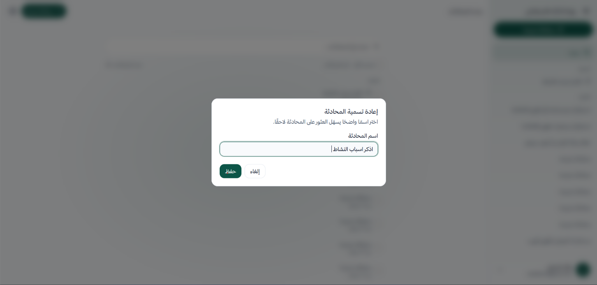
  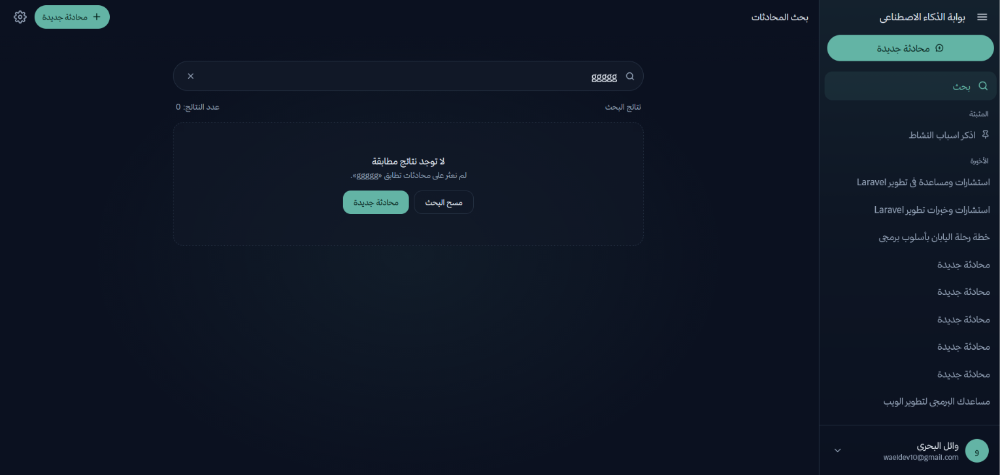
</p>

## المزايا

### واجهة الويب

- تسجيل الحساب والدخول وإدارة الملف الشخصي.
- إنشاء المحادثات والبحث فيها وتثبيتها وإعادة تسميتها وحذفها.
- بث ردود المساعد مباشرة، وتحميل الرسائل الأقدم عند التمرير في المحادثات الطويلة.
- تعديل رسائل المستخدم وإعادة توليد ردود المساعد.
- إنشاء شخصيات للمساعد وإدارة الشخصية النشطة.
- الوضعان الفاتح والداكن، مع تخصيص ألوان الواجهة ودعم العربية واتجاه RTL.
- عرض كتل الأكواد مع زر نسخ.

### واجهة API

- API بإصدار `/api/v1` ومصادقة Sanctum باستخدام Bearer Token.
- تسجيل الحساب والدخول وإبطال الرموز وإدارة الملف الشخصي وكلمة المرور.
- إنشاء المحادثات وإدارتها والبحث فيها مع الترقيم الصفحي.
- بدء محادثة برسالة أولى ورد، وإرسال الرسائل وتعديلها وإعادة توليد الردود.
- جلب الرسائل بترقيم المؤشر، وإدارة شخصيات المساعد.
- استجابات موحدة للأخطاء والتحقق من المدخلات.

يدعم الويب بث ردود AI مباشرة، بينما تكون عمليات التوليد في API متزامنة. راجع [دليل API](docs/api/api.md) و[مخطط OpenAPI](docs/api/openapi.yaml) للتفاصيل والأمثلة.

## التقنيات

| الجزء | التقنيات |
| --- | --- |
| الخادم | PHP 8.3+، Laravel 13 |
| الواجهة التفاعلية | Livewire 4، Alpine.js |
| CSS وتجميع الأصول | Tailwind CSS 4، Vite 8 |
| قاعدة البيانات | MySQL افتراضيًا وفق `.env.example`، مع Eloquent وmigrations |
| مصادقة API | Laravel Sanctum |
| الاختبارات | Pest |

تستخدم واجهة الويب Livewire والخدمات المشتركة، وتستدعي طبقة AI المزود المحدد من الإعدادات. تستقبل واجهة API الطلبات عبر Form Requests وControllers وResources، ثم تستخدم الخدمات نفسها لمنطق المحادثات.

## مزودو الذكاء الاصطناعي

تدعم طبقة AI بروتوكولات Chat Completions وOpenAI Responses وAnthropic Messages وGemini Interactions. وتشمل إعدادات الاتصالات في `config/ai.php` ملفات مثل OpenAI وOpenRouter وAnthropic وGemini وDeepSeek وOllama وQwen وKimi وGrok.

لإضافة مزود، أضف أسماء متغيراته إلى `.env.example` بصيغة `KEY=value` من دون وضع مفتاح فعلي، ثم أضف اتصالًا في `config/ai.php` يقرأ القيم عبر `env(...)` ويحدد `driver` و`api_key` و`base_url` و`model` و`timeout`، إضافة إلى إعدادات البروتوكول عند الحاجة. اتبع بنية الاتصالات الموجودة. استخدم أحد المشغلات الحالية إذا كان المزود يدعم بروتوكولًا مدعومًا؛ أما البروتوكول الجديد فيحتاج مشغّلًا وتسجيله في `AiDriverFactory`. بعد ذلك ضع القيم الفعلية محليًا في `.env` فقط، ولا ترفع مفاتيح API إلى Git.

## التشغيل محليًا

### المتطلبات

- PHP 8.3 أو أحدث، مع إضافات PHP المطلوبة من Composer.
- Composer.
- MySQL وقاعدة بيانات يستطيع التطبيق الاتصال بها.
- Node.js وnpm.

### الإعداد

من مجلد المشروع، ثبّت اعتماديات PHP:

```bash
composer install
```

إذا لم يكن ملف `.env` موجودًا، انسخ `.env.example` إليه. في PowerShell:

```powershell
Copy-Item .env.example .env
```

اضبط اتصال قاعدة البيانات في `.env` وأنشئ قاعدة البيانات. يستخدم المثال الافتراضي الاسم `ai_gateway_chat`:

```dotenv
DB_CONNECTION=mysql
DB_HOST=127.0.0.1
DB_PORT=3306
DB_DATABASE=ai_gateway_chat
DB_USERNAME=your_username
DB_PASSWORD=your_password
```

أنشئ مفتاح التطبيق:

```bash
php artisan key:generate
```

اختر مزود AI واضبط متغيراته. مثال اتصال OpenAI:

```dotenv
AI_CONNECTION=openai
OPENAI_API_KEY=your_api_key
OPENAI_MODEL=your_model
```

أنشئ الجداول وسجّل الشخصية الافتراضية، ثم ثبّت اعتماديات الواجهة وابنِ الأصول:

```bash
php artisan migrate --seed
npm install
npm run build
```

### تشغيل وضع التطوير

شغّل Laravel في نافذة طرفية:

```bash
php artisan serve
```

وفي نافذة أخرى شغّل Vite:

```bash
npm run dev
```

افتح `http://localhost:8000` وأنشئ حسابًا للبدء.

## الاختبارات والتنسيق

```bash
php artisan test --compact
vendor/bin/pint --test
```

## الترخيص

هذا المشروع مرخص بموجب MIT License.
